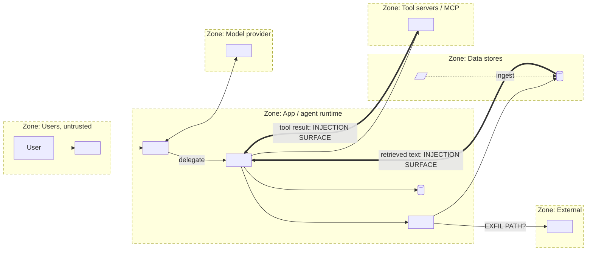

# AI Product Threat Model: Template

> **Product:** `<name>` · **Owner team:** `<team>` · **Security reviewer:** `<name>` · **Date:** `<YYYY-MM-DD>` · **Version:** `<v0.1>`
> **Status:** Draft / In review / Approved / Re-review due `<date>`

---

## How to use this (read first, one page)

**What this is.** A lightweight threat model for any product that uses an LLM, RAG or agents. It takes **about 1 day of team time** and gives you three things: a data-flow diagram, a ranked threat table, and a list of controls with owners. Security reviews it with you. It isn't a gate you fill in alone.

**When to do it.**
- Before the first production launch of any LLM feature.
- When you add a **new tool/action** the model can call, a **new data source** for retrieval, a **new model or provider**, or **a second agent**.
- Every 6 months otherwise.

**Who should be in the room.** One engineer who knows the code, the product owner, and a security partner. 90 minutes for steps 1–2. The rest can be async.

**The five steps.**

| # | Step | Time | Output |
|---|---|---|---|
| 1 | Describe the system (section 1) | 30 min | Scope, components, data classes |
| 2 | Draw the data-flow diagram and mark trust boundaries (section 2) | 60 min | Mermaid diagram + boundary table |
| 3 | Walk the threat checklist against every boundary (section 3) | 2 h | Threat table, one row per threat |
| 4 | Rate each threat and pick a control (section 3) | 1 h | L/I ratings, control, owner, due date |
| 5 | Agree the top risks and sign off (section 5) | 30 min | Top 5, accepted risks, sign-off |

**Rules that make this useful.**
1. **Every row names a control and an owner.** A threat without a control is either accepted (write down who accepted it) or unfinished.
2. **Controls go in code, not prompts.** "Tell the model not to do X" is a mitigation, not a control. The control is the check in the tool, the gateway or the data layer that enforces it when the model gets it wrong.
3. **Assume untrusted content reaches the model.** Every retrieved doc, tool result, email, web page or ticket can contain instructions. Ask "what's the worst tool call an attacker could cause from here?"
4. **Assume the system prompt leaks.** Don't put secrets or authorization logic in it.
5. **Be honest about IDs.** If no ATLAS technique fits, use the closest one and write *(closest)*.

**References:** [OWASP Top 10 for LLM Apps](https://genai.owasp.org/llm-top-10/) · [OWASP Agentic Top 10](https://genai.owasp.org/) · [MITRE ATLAS](https://atlas.mitre.org/matrices/ATLAS) · STRIDE.

---

## 1. System description

**What does the product do?** `<one paragraph: user, task, value>`

**Users and identity**

| Question | Answer |
|---|---|
| Who are the users? (employees, customers, anonymous, other systems) | `<>` |
| How are they authenticated? (SSO/OIDC, API key, none) | `<>` |
| How does user identity reach the tools? (trusted context / model argument / not at all) | `<>` |
| Roles that see different data | `<>` |

**AI components**

| Component | Type (agent / model / RAG / tool / MCP server / store) | Provider & version | Can it take actions? |
|---|---|---|---|
| `<e.g. main agent>` | `<>` | `<pinned model id>` | `<Y/N: which>` |
| `<>` | `<>` | `<>` | `<>` |

**Tools the model can call** (list every one; this is the agency surface)

| Tool | What it does | Read / Write / External | Who can trigger it | Human approval? |
|---|---|---|---|---|
| `<>` | `<>` | `<>` | `<>` | `<Y/N>` |

**Data the system touches**

| Data | Classification (public / internal / confidential / regulated) | Where stored | Sent to third party? |
|---|---|---|---|
| `<>` | `<>` | `<>` | `<Y/N: who>` |

**Out of scope:** `<e.g. underlying cloud platform, already covered by X review>`

---

## 2. Data-flow diagram and trust boundaries

Draw every component from section 1. Put each **trust zone** in a dashed subgraph. Use a **thick arrow `==>`** wherever untrusted content enters the model's context.

*Tip: keep node labels in quotes and avoid bare `()` so GitHub renders it. Preview at mermaid.live.*

**Trust boundaries.** One row per arrow that crosses a dashed edge.

| # | Boundary (from → to) | What crosses it | Who controls the content? | Risk in one line |
|---|---|---|---|---|
| TB1 | User → app | `<prompt, identity>` | `<user>` | `<direct injection, spoofed identity?>` |
| TB2 | App → model provider | `<prompts, context, data>` | `<>` | `<data leaves org; model chooses tools>` |
| TB3 | `<store>` → model context | `<retrieved text>` | `<who can write it?>` | `<indirect injection; over-retrieval>` |
| TB4 | Agent → tool / MCP | `<tool args>` | `<model>` | `<authz on tool side?>` |
| TB5 | Tool → outside world | `<>` | `<model>` | `<exfil path?>` |
| TB_ | `<>` | `<>` | `<>` | `<>` |

**Injection surfaces.** List every place where content the current user didn't write enters the model context:
1. `<e.g. retrieved documents: who can edit the source?>`
2. `<e.g. tool results containing other users' text>`

---

## 3. Threat table

**How to fill it.** Go through the checklist in section 4 for each trust boundary. Add one row per threat that applies, and delete checklist items that don't (note why in section 5).

**Ratings.** Likelihood: **H** = exploitable today by any user or with public techniques; **M** = needs insider access or a chain of steps; **L** = theoretical. Impact: **H** = regulated/confidential data out, account takeover, money or safety; **M** = internal data or limited abuse; **L** = nuisance.

| ID | Component | Threat | OWASP LLM | ATLAS technique | STRIDE | L | I | Control | Owner | Due | Status |
|---|---|---|---|---|---|---|---|---|---|---|---|
| T01 | `<component / TB#>` | `<attacker does X via Y, causing Z>` | `<LLM0x>` | `<AML.Txxxx name>` | `<S/T/R/I/D/E>` | `<H/M/L>` | `<H/M/L>` | `<enforced-in-code control>` | `<name>` | `<date>` | Open |
| T02 | | | | | | | | | | | |
| T03 | | | | | | | | | | | |

**STRIDE coverage.** Every category should have at least one row, or a reason it doesn't apply.

| STRIDE | Threat IDs | If none, why |
|---|---|---|
| Spoofing | | |
| Tampering | | |
| Repudiation | | |
| Information disclosure | | |
| Denial of service | | |
| Elevation of privilege | | |

---

## 4. Threat checklist (prompts)

Ask each question about **your** system. Every "yes" or "don't know" becomes a row in section 3.

**Prompt injection & content trust**
- [ ] Can untrusted text (docs, tickets, emails, web pages, tool results) reach the model? Who can write that text? → LLM01 · AML.T0051.001
- [ ] Could injected text make the model call a **write** or **external** tool? What's the worst call? → LLM01/LLM06 · AML.T0053
- [ ] Can users talk the model out of its rules (jailbreak)? → LLM01 · AML.T0054
- [ ] Does a sub-agent trust whatever the parent agent passes it? → LLM06 · (agentic)

**Data exposure**
- [ ] Does retrieval filter by the **caller's** role/tenant, or can anyone retrieve anything? → LLM02/LLM08 · AML.T0057
- [ ] Do tools check that the caller owns the object (ticket, record, file)? → LLM02 · *(BOLA)*
- [ ] Is there an output DLP check on answers **and** on tool arguments (email bodies, API payloads)? → LLM05/LLM02
- [ ] Is regulated data (PII, PHI, card, secrets) embedded, logged, or sent to a third-party model? → LLM02/LLM08
- [ ] Would a system-prompt leak expose anything sensitive? → LLM07 · AML.T0056

**Agency & tools**
- [ ] List every tool. Which ones write, delete, pay, email externally or change credentials? Do they need human approval? → LLM06
- [ ] Does the tool layer get user identity from trusted context, or from a model-generated argument? → LLM06 · AML.T0012
- [ ] Are MCP/tool servers authenticated and authorized per caller? Can they be reached without going through the agent? → LLM06 · AML.T0049
- [ ] Is there a channel that could carry data out (email, webhook, URL fetch, markdown image)? → AML.T0086 / AML.T0025

**Abuse & availability**
- [ ] Rate limits, token budgets and caps on tool calls/loops per user? → LLM10 · AML.T0034 / AML.T0029

**Supply chain & integrity**
- [ ] Are model versions pinned (no `-latest`)? Dependencies locked and scanned? AI-BOM kept? → LLM03 · AML.T0010
- [ ] Can someone poison the RAG corpus or fine-tuning data? → LLM04 · AML.T0070

**Detect & respond**
- [ ] Is there an audit log of every model call, tool call, args, caller and agent hop? → *(detection)*
- [ ] Do logs avoid storing secrets/PII in plaintext? → LLM02
- [ ] Are there alerts on high-risk tool calls? Is there a kill switch to disable a tool fast?

**Correctness & harm**
- [ ] Can a wrong or hallucinated answer cause real harm (security, legal, money, health)? → LLM09

---

## 5. Summary & sign-off

**Top 5 risks** (highest L×I, or a full kill chain that works today)

| # | Threat IDs | Why it's top | Control | Owner | Due |
|---|---|---|---|---|---|
| 1 | | | | | |
| 2 | | | | | |
| 3 | | | | | |
| 4 | | | | | |
| 5 | | | | | |

**Accepted risks** (each one needs a named accepter and a review date)

| Threat ID | Why accepted | Accepted by | Review by |
|---|---|---|---|
| | | | |

**Not applicable** (checklist items you skipped, and why)

- `<item>`: `<reason>`

**Sign-off**

| Role | Name | Date |
|---|---|---|
| Product owner | | |
| Engineering lead | | |
| Security reviewer | | |

**Re-review triggers:** new tool · new data source · new model/provider · new agent · new user population · 6 months elapsed.
