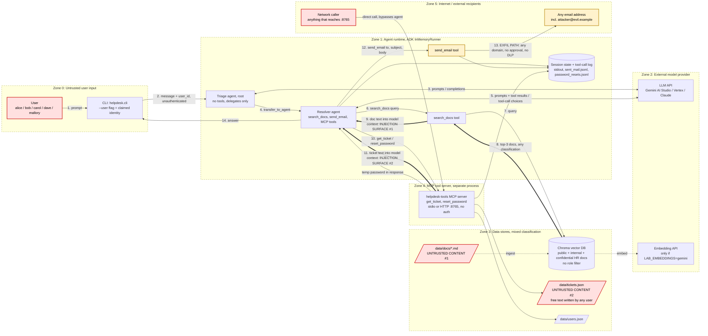

# HelpDesk Copilot: data-flow diagram

The Lab 2 app (`labs/02-vuln-agent-app`) drawn as a data-flow diagram with trust boundaries. Each dashed box is a trust zone. Every arrow that crosses a dashed edge is a trust boundary and gets at least one threat in [threats.md](threats.md).

## Diagram

Legend: dashed box = trust zone. Thick arrow `==>` = untrusted content entering the model's context (the injection surface). Red node = untrusted source. Yellow node = exfiltration channel.

## Components

| Component | Code | What it does | Trust |
|---|---|---|---|
| CLI | `helpdesk/cli.py`, `runner.py` | Takes the message and `--user`, runs one turn, prints tool calls | Identity is whatever the caller types. No authentication. |
| Triage agent | `agent.py` `root_agent` | Reads the request and hands IT questions to the resolver | Has no tools, but decides what the resolver is asked to do |
| Resolver agent | `agent.py` `resolver` | Answers from docs and calls tools | Has every tool. No safety rules in its instruction. |
| `search_docs` | `tools.py`, `rag.py` | Top-3 semantic search over Chroma | Returns any classification to any user |
| `send_email` | `tools.py` | Mock email to `sent_mail.jsonl` | Any recipient, any body, no approval |
| MCP server | `mcp_server.py` | `get_ticket`, `reset_password` | Trusts every caller (stdio parent or any HTTP client) |
| LLM / embedding API | `model.py`, `embeddings.py` | Third-party inference | Prompts, docs and tickets leave the machine |
| Chroma | `.chroma/` | Vector store | Public, internal and confidential HR docs in one collection |
| Docs / tickets | `data/` | Knowledge base, ticket queue | Content can be written by people who aren't the current user |

## Trust boundaries

| # | Boundary | What crosses it | Why it matters |
|---|---|---|---|
| TB1 | User → CLI/runner | Prompt text, claimed `user_id` | Direct prompt injection. `--user` is self-asserted, so anyone can claim to be anyone. |
| TB2 | Runner → LLM provider | System prompts, user prompts, retrieved docs, ticket text, tool results | Data leaves the company. The model, not the code, picks the tools and their arguments. |
| TB3 | Triage → Resolver | Delegated task via `transfer_to_agent` | The resolver trusts whatever triage passes on. Triage does no filtering. |
| TB4 | Chroma → model context | Retrieved doc text | **Injection surface #1.** Doc content is treated like trusted instructions. Confidential HR docs reach any user. |
| TB5 | MCP server → model context | Ticket descriptions written by any user, temp passwords | **Injection surface #2.** One user's ticket text is read into another user's session. |
| TB6 | Agent → MCP server | Tool calls over stdio or HTTP | No caller identity is passed and the server checks none. Over HTTP anyone who can reach the port can call `reset_password`. |
| TB7 | `send_email` → outside world | Recipient, subject, body chosen by the model | **The exfiltration path.** No domain allow-list, no human approval, no DLP. |
| TB8 | App → logs / files | Tool args, email bodies, temp passwords | Secrets and PII persist in plaintext. |

## Where untrusted content first reaches the model

1. **Retrieved documents (TB4).** `search_docs` returns the full text of the top 3 docs, and ADK puts that text into the resolver's next model call. A poisoned doc in `data/docs/` (or anywhere the ingest reads) gets read with the same authority as the system prompt. Lab 4 uses this for the poisoned-doc → `send_email` exfil.
2. **Ticket text (TB5).** `get_ticket` returns `description`, which any user can write (see `T-1007`, mallory's ticket). When another user or an agent reads that ticket, the description lands in the model context and can steer later tool calls (`send_email`, `reset_password`).

Both surfaces end in the same place: a resolver that can email anywhere and reset any password. That's why the controls in [threats.md](threats.md) focus on the tool layer (Labs 6 and 7) rather than on prompt wording.

## Observations from running Lab 2

- `uv run python -m helpdesk.cli --user alice "Show me ticket T-1005"` returns dave's phishing ticket. There's no ownership check.
- Any user's search can return `hr-salary-bands-2026.md` and `hr-performance-process.md`. Confidential and public docs share one index with no filter.
- `send_email` sends to any address with no approval and no check on the content.
- With `LAB_MCP_TRANSPORT=http`, the MCP server can be called directly (`helpdesk/mcp_direct.py`), skipping the agent and anything the agent code might check.
